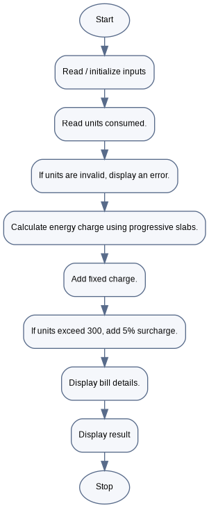

# Case Study 1: Progressive Electricity Billing

## Problem statement
Calculate a household electricity bill using consumption slabs, a fixed charge, and a surcharge for high consumption.

## Objectives
- Implement a logical solution using beginner Python concepts.
- Validate the relevant inputs and calculate the required result.
- Display a clear summary.

## Assumptions
Use the units consumed as a non-negative number. The slab rates and fixed charge are illustrative. A surcharge is applied only when consumption exceeds 300 units.

## Algorithm
1. Read units consumed.
2. If units are invalid, display an error.
3. Calculate energy charge using progressive slabs.
4. Add fixed charge.
5. If units exceed 300, add 5% surcharge.
6. Display bill details.

## Flowchart


## Pseudocode
```text
START
INPUT units
IF units < 0: DISPLAY invalid
ELSE: calculate slab charges
ADD fixed charge
IF units > 300: ADD 5% surcharge
DISPLAY total bill
STOP
```

## Python source code
```python
units = float(input("Units consumed: "))
if units < 0:
    print("Invalid units")
else:
    charge = 0
    if units <= 100:
        charge = units * 1.5
    elif units <= 200:
        charge = 100 * 1.5 + (units - 100) * 2.5
    elif units <= 300:
        charge = 100 * 1.5 + 100 * 2.5 + (units - 200) * 4
    else:
        charge = 100 * 1.5 + 100 * 2.5 + 100 * 4 + (units - 300) * 5
    fixed = 50
    subtotal = charge + fixed
    surcharge = subtotal * 0.05 if units > 300 else 0
    total = subtotal + surcharge
    print("Energy charge: Rs.", round(charge, 2))
    print("Fixed charge: Rs.", fixed)
    print("Surcharge: Rs.", round(surcharge, 2))
    print("Total bill: Rs.", round(total, 2))
```

## Test cases
| Input / scenario | Expected result |
|---|---|
| 100 | Rs. 200.00 total (150 + 50) |
| 250 | Rs. 650.00 total (600 + 50) |
| 350 | Rs. 1,155.00 total (1,100 + 55 surcharge) |

## Output example
```text
units = 350
charge = 100*1.5 + 100*2.5 + 100*4 + 50*5
subtotal = charge + 50
surcharge = subtotal*0.05
print(charge, subtotal+surcharge)
```

## Conclusion
Calculate slab-wise charges, add the fixed charge, apply the high-consumption surcharge, and display the total.
