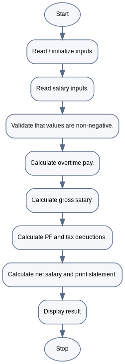

# Case Study 2: Employee Payroll and Deduction Analysis

## Problem statement
Compute gross salary from basic pay, allowances, overtime, and incentive, then deduct provident fund and tax to produce net salary.

## Objectives
- Implement a logical solution using beginner Python concepts.
- Validate the relevant inputs and calculate the required result.
- Display a clear summary.

## Assumptions
Basic pay, allowances, overtime hours, overtime rate, and incentive are entered as non-negative values. PF is 8% of basic pay and tax is 5% of gross salary.

## Algorithm
1. Read salary inputs.
2. Validate that values are non-negative.
3. Calculate overtime pay.
4. Calculate gross salary.
5. Calculate PF and tax deductions.
6. Calculate net salary and print statement.

## Flowchart


## Pseudocode
```text
START
INPUT basic, allowances, overtime hours, overtime rate, incentive
VALIDATE all inputs
 overtime pay = hours * rate
 gross = basic + allowances + overtime pay + incentive
 PF = 8% of basic; tax = 5% of gross
 net = gross - PF - tax
DISPLAY salary statement
STOP
```

## Python source code
```python
basic = float(input("Basic pay: Rs. "))
allowances = float(input("Allowances: Rs. "))
hours = float(input("Overtime hours: "))
rate = float(input("Overtime rate per hour: Rs. "))
incentive = float(input("Incentive: Rs. "))
if basic < 0 or allowances < 0 or hours < 0 or rate < 0 or incentive < 0:
    print("Invalid input: values must be non-negative")
else:
    overtime = hours * rate
    gross = basic + allowances + overtime + incentive
    pf = basic * 0.08
    tax = gross * 0.05
    net = gross - pf - tax
    print("Gross salary: Rs.", round(gross, 2))
    print("PF deduction: Rs.", round(pf, 2))
    print("Tax deduction: Rs.", round(tax, 2))
    print("Net salary: Rs.", round(net, 2))
```

## Test cases
| Input / scenario | Expected result |
|---|---|
| Basic 20000, allowance 3000, OT 5h at 200, incentive 1000 | Gross Rs. 25,000; PF Rs. 1,600; tax Rs. 1,250; net Rs. 22,150 |
| All inputs 0 | Gross Rs. 0; deductions Rs. 0; net Rs. 0 |
| Negative basic pay | Invalid input |

## Output example
```text
basic=20000; allowances=3000; hours=5; rate=200; incentive=1000
overtime=hours*rate; gross=basic+allowances+overtime+incentive
pf=basic*0.08; tax=gross*0.05; net=gross-pf-tax
print(gross, pf, tax, net)
```

## Conclusion
Calculate overtime, gross salary, deductions, and take-home salary using arithmetic operations.
