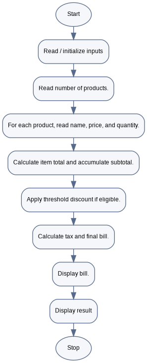

# Case Study 3: Retail Billing with Multiple Discount Rules

## Problem statement
Generate an itemized bill for multiple products using quantity, category tax, and a threshold discount.

## Objectives
- Implement a logical solution using beginner Python concepts.
- Validate the relevant inputs and calculate the required result.
- Display a clear summary.

## Assumptions
Product prices and quantities are non-negative. A 10% discount applies when subtotal is at least Rs. 2,000. Tax is 5% on discounted subtotal. Sample items are entered one by one.

## Algorithm
1. Read number of products.
2. For each product, read name, price, and quantity.
3. Calculate item total and accumulate subtotal.
4. Apply threshold discount if eligible.
5. Calculate tax and final bill.
6. Display bill.

## Flowchart


## Pseudocode
```text
START
INPUT item count
SET subtotal = 0
REPEAT for each item: INPUT name, price, quantity
subtotal = subtotal + price * quantity
IF subtotal >= 2000: discount = 10%
ELSE discount = 0
tax = 5% of (subtotal - discount)
DISPLAY final amount
STOP
```

## Python source code
```python
n = int(input("Number of products: "))
subtotal = 0
if n <= 0:
    print("Invalid product count")
else:
    for i in range(n):
        name = input("Product name: ")
        price = float(input("Price: Rs. "))
        quantity = int(input("Quantity: "))
        if price < 0 or quantity < 0:
            print("Invalid item; item skipped")
        else:
            item_total = price * quantity
            subtotal = subtotal + item_total
            print(name, "- Rs.", round(item_total, 2))
    discount = subtotal * 0.10 if subtotal >= 2000 else 0
    taxable = subtotal - discount
    tax = taxable * 0.05
    total = taxable + tax
    print("Subtotal: Rs.", round(subtotal, 2))
    print("Discount: Rs.", round(discount, 2))
    print("Tax: Rs.", round(tax, 2))
    print("Total: Rs.", round(total, 2))
```

## Test cases
| Input / scenario | Expected result |
|---|---|
| 1 product: price 1000, qty 1 | Subtotal Rs. 1,000; discount Rs. 0; tax Rs. 50; total Rs. 1,050 |
| 2 products: 1200 x 1 and 900 x 1 | Subtotal Rs. 2,100; discount Rs. 210; tax Rs. 94.50; total Rs. 1,984.50 |
| Product count 0 | Invalid product count |

## Output example
```text
subtotal=2100
discount=subtotal*0.10
tax=(subtotal-discount)*0.05
total=subtotal-discount+tax
print(subtotal, discount, tax, total)
```

## Conclusion
Use a loop to process items, total the bill, apply the discount threshold, calculate tax, and display the final payable amount.
