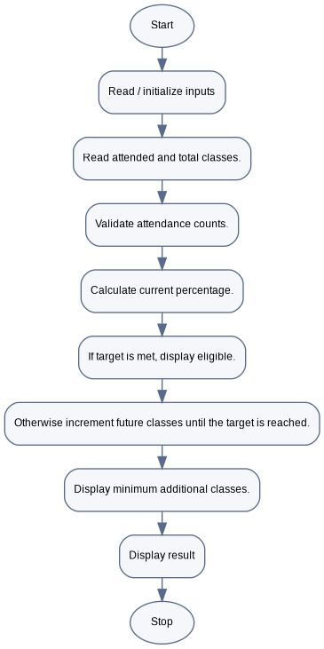

# Case Study 4: Attendance Recovery Computation

## Problem statement
Determine current attendance percentage and calculate how many additional classes a student must attend consecutively to meet an attendance requirement.

## Objectives
- Implement a logical solution using beginner Python concepts.
- Validate the relevant inputs and calculate the required result.
- Display a clear summary.

## Assumptions
Attendance counts are valid when attended classes are between 0 and classes held. Future classes are assumed to be attended fully. The target is 75%.

## Algorithm
1. Read attended and total classes.
2. Validate attendance counts.
3. Calculate current percentage.
4. If target is met, display eligible.
5. Otherwise increment future classes until the target is reached.
6. Display minimum additional classes.

## Flowchart


## Pseudocode
```text
START
INPUT attended, held
IF invalid counts: DISPLAY error
ELSE calculate percentage
IF percentage >= 75: DISPLAY target met
ELSE SET extra = 0
WHILE (attended + extra) / (held + extra) < 0.75: extra = extra + 1
DISPLAY extra
STOP
```

## Python source code
```python
attended = int(input("Classes attended: "))
held = int(input("Total classes held: "))
if attended < 0 or held < 0 or attended > held:
    print("Invalid attendance data")
else:
    percentage = (attended / held * 100) if held != 0 else 0
    print("Current attendance: ", round(percentage, 2), "%")
    if percentage >= 75:
        print("Attendance requirement met")
        print("Additional classes required: 0")
    elif held == 0:
        print("No classes held yet; recovery cannot be calculated")
    else:
        extra = 0
        while (attended + extra) / (held + extra) < 0.75:
            extra = extra + 1
        print("Additional consecutive classes to attend: ", extra)
```

## Test cases
| Input / scenario | Expected result |
|---|---|
| 30 attended of 40 | 75%; additional classes required: 0 |
| 20 attended of 40 | 50%; additional classes required: 40 |
| Attended 0, held 0 | Recovery cannot be calculated because no classes have been held |

## Output example
```text
attended=20; held=40; extra=0
while (attended+extra)/(held+extra) < 0.75:
    extra += 1
print(extra)
```

## Conclusion
Calculate current attendance and use a while loop to find the smallest number of future classes, assuming all are attended, needed to reach 75%.
