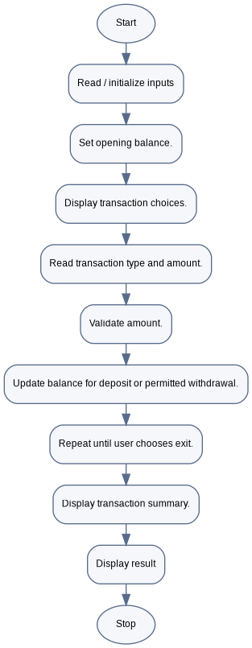

# Case Study 5: ATM Transaction Sequence Simulation

## Problem statement
Simulate a sequence of deposits and withdrawals, update account balance, reject invalid amounts, and summarize transactions.

## Objectives
- Implement a logical solution using beginner Python concepts.
- Validate the relevant inputs and calculate the required result.
- Display a clear summary.

## Assumptions
This is a practice simulation only and does not connect to a real bank. Opening balance is Rs. 5,000. Deposits and withdrawals must be positive. Withdrawals cannot exceed the available balance.

## Algorithm
1. Set opening balance.
2. Display transaction choices.
3. Read transaction type and amount.
4. Validate amount.
5. Update balance for deposit or permitted withdrawal.
6. Repeat until user chooses exit.
7. Display transaction summary.

## Flowchart


## Pseudocode
```text
START
SET balance = 5000
SET deposits = 0, withdrawals = 0
REPEAT: INPUT transaction type
IF type is deposit: INPUT amount; validate; update balance
ELSE IF type is withdrawal: INPUT amount; validate funds; update balance
ELSE IF type is exit: stop loop
DISPLAY balance and totals
STOP
```

## Python source code
```python
balance = 5000
deposits = 0
withdrawals = 0
while True:
    print("1.Deposit  2.Withdraw  3.Balance  4.Exit")
    choice = input("Choice: ")
    if choice == "1":
        amount = float(input("Deposit amount: Rs. "))
        if amount > 0:
            balance += amount
            deposits += amount
        else:
            print("Enter a positive amount")
    elif choice == "2":
        amount = float(input("Withdrawal amount: Rs. "))
        if amount <= 0:
            print("Enter a positive amount")
        elif amount <= balance:
            balance -= amount
            withdrawals += amount
        else:
            print("Insufficient balance")
    elif choice == "3":
        print("Balance: Rs.", round(balance, 2))
    elif choice == "4":
        break
    else:
        print("Invalid choice")
print("Deposits: Rs.", round(deposits, 2))
print("Withdrawals: Rs.", round(withdrawals, 2))
print("Closing balance: Rs.", round(balance, 2))
```

## Test cases
| Input / scenario | Expected result |
|---|---|
| Deposit 1000, withdraw 500, exit | Deposits Rs. 1,000; withdrawals Rs. 500; closing balance Rs. 5,500 |
| Withdraw 6000 from opening balance | Insufficient balance; closing balance Rs. 5,000 |
| Deposit -20 | Rejected as non-positive amount |

## Output example
```text
balance=5000; deposits=1000; withdrawals=500
balance += deposits; balance -= withdrawals
print(balance)
```

## Conclusion
Use a loop and conditionals to simulate deposits, withdrawals, balance enquiry, and exit while maintaining a running balance.
