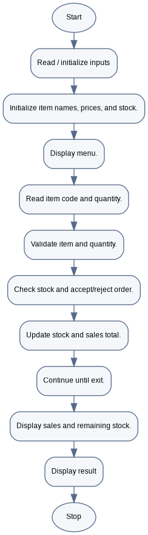

# Case Study 6: Smart Canteen Order and Stock Management

## Problem statement
Process orders for canteen items, check stock, calculate bills, update inventory, and summarize sales.

## Objectives
- Implement a logical solution using beginner Python concepts.
- Validate the relevant inputs and calculate the required result.
- Display a clear summary.

## Assumptions
Initial stock and prices are sample values. Customers enter item codes and quantities. An order is accepted only if requested quantity is positive and available stock is sufficient.

## Algorithm
1. Initialize item names, prices, and stock.
2. Display menu.
3. Read item code and quantity.
4. Validate item and quantity.
5. Check stock and accept/reject order.
6. Update stock and sales total.
7. Continue until exit.
8. Display sales and remaining stock.

## Flowchart


## Pseudocode
```text
START
SET menu, stock, prices
REPEAT INPUT item code (0 exits)
IF code valid: INPUT quantity
IF quantity positive and stock sufficient: calculate cost; update stock and sales
ELSE DISPLAY error
UNTIL code 0
DISPLAY sales and stock
STOP
```

## Python source code
```python
items = ["Tea", "Sandwich", "Juice"]
prices = [15, 40, 30]
stock = [20, 10, 15]
sales = 0
while True:
    print("0.Exit  1.Tea Rs.15  2.Sandwich Rs.40  3.Juice Rs.30")
    code = int(input("Item code: "))
    if code == 0:
        break
    if code < 1 or code > 3:
        print("Invalid item code")
    else:
        quantity = int(input("Quantity: "))
        index = code - 1
        if quantity <= 0:
            print("Quantity must be positive")
        elif quantity > stock[index]:
            print("Not enough stock")
        else:
            amount = prices[index] * quantity
            stock[index] = stock[index] - quantity
            sales = sales + amount
            print("Order accepted. Bill: Rs.", amount)
print("Total sales: Rs.", sales)
print("Remaining stock:")
for i in range(3):
    print(items[i], stock[i])
```

## Test cases
| Input / scenario | Expected result |
|---|---|
| Tea code 1 quantity 2 then exit | Order accepted; bill Rs. 30; remaining tea stock 18 |
| Sandwich code 2 quantity 11 | Not enough stock; sandwich stock remains 10 |
| Code 5 | Invalid item code |

## Output example
```text
prices=[15,40,30]; stock=[20,10,15]; code=1; quantity=2
index=code-1; amount=prices[index]*quantity; stock[index]-=quantity
print(amount, stock)
```

## Conclusion
Use lists and loops to handle item selection, validate stock, calculate bills, update inventory, and print a sales summary.
