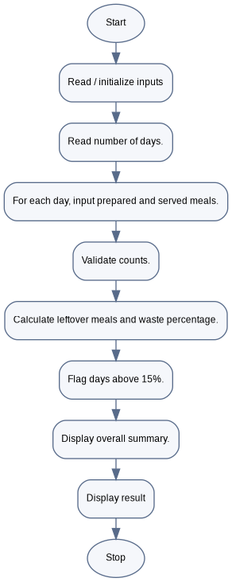

# Case Study 7: Food Waste Monitoring System

## Problem statement
Monitor prepared meals, meals served, and leftovers across several days, then calculate waste percentage and flag days above the chosen threshold.

## Objectives
- Implement a logical solution using beginner Python concepts.
- Validate the relevant inputs and calculate the required result.
- Display a clear summary.

## Assumptions
Prepared and served meal counts are non-negative integers. Served meals cannot exceed prepared meals. Waste percentage is leftovers divided by meals prepared. The sample acceptable waste threshold is 15%.

## Algorithm
1. Read number of days.
2. For each day, input prepared and served meals.
3. Validate counts.
4. Calculate leftover meals and waste percentage.
5. Flag days above 15%.
6. Display overall summary.

## Flowchart


## Pseudocode
```text
START
INPUT days
FOR each day: INPUT prepared, served
IF invalid or served > prepared: report invalid
ELSE leftovers = prepared - served; waste percent = leftovers/prepared * 100
IF waste percent > 15: flag
DISPLAY totals and flagged days
STOP
```

## Python source code
```python
days = int(input("Number of days: "))
if days <= 0:
    print("Invalid day count")
else:
    total_prepared = 0
    total_served = 0
    for day in range(1, days + 1):
        prepared = int(input("Meals prepared on day " + str(day) + ": "))
        served = int(input("Meals served: "))
        if prepared < 0 or served < 0 or served > prepared:
            print("Invalid counts; day skipped")
        else:
            leftover = prepared - served
            waste = (leftover / prepared * 100) if prepared != 0 else 0
            total_prepared += prepared
            total_served += served
            print("Leftovers:", leftover, "Waste:", round(waste, 2), "%")
            if waste > 15:
                print("Waste exceeds 15% target")
    overall_leftover = total_prepared - total_served
    overall_waste = (overall_leftover / total_prepared * 100) if total_prepared != 0 else 0
    print("Overall leftover meals:", overall_leftover)
    print("Overall waste percentage:", round(overall_waste, 2), "%")
```

## Test cases
| Input / scenario | Expected result |
|---|---|
| Prepared 100, served 90 | 10 leftovers; waste 10%; target not exceeded |
| Prepared 80, served 60 | 20 leftovers; waste 25%; target exceeded |
| Prepared 0, served 0 | 0 leftovers; waste 0% |

## Output example
```text
prepared=80; served=60
leftover=prepared-served
waste=leftover/prepared*100 if prepared else 0
print(leftover, waste)
```

## Conclusion
Calculate daily and overall leftovers and waste percentages, and identify days exceeding the 15% target.
