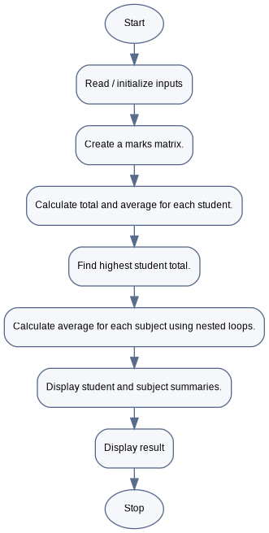

# Case Study 8: Student Marks Matrix Analysis

## Problem statement
Store marks of students in a nested list and calculate each student total and average, along with subject-wise averages.

## Objectives
- Implement a logical solution using beginner Python concepts.
- Validate the relevant inputs and calculate the required result.
- Display a clear summary.

## Assumptions
Marks are illustrative. There are three students and three subjects. Each mark is between 0 and 100. Subject order is Python, Mathematics, and English.

## Algorithm
1. Create a marks matrix.
2. Calculate total and average for each student.
3. Find highest student total.
4. Calculate average for each subject using nested loops.
5. Display student and subject summaries.

## Flowchart


## Pseudocode
```text
START
SET marks as nested list
FOR each student row: calculate total and average
FIND maximum total
FOR each subject column: sum marks across students and divide by student count
DISPLAY summaries
STOP
```

## Python source code
```python
students = ["Asha", "Bala", "Charan"]
subjects = ["Python", "Maths", "English"]
marks = [[85, 78, 90], [72, 88, 80], [91, 84, 76]]
totals = []
for i in range(len(marks)):
    total = 0
    for j in range(len(marks[i])):
        total += marks[i][j]
    average = total / len(marks[i])
    totals.append(total)
    print(students[i], "Total:", total, "Average:", round(average, 2))
print("Top student:", students[totals.index(max(totals))])
for j in range(len(subjects)):
    subject_total = 0
    for i in range(len(marks)):
        subject_total += marks[i][j]
    print(subjects[j], "Average:", round(subject_total / len(marks), 2))
```

## Test cases
| Input / scenario | Expected result |
|---|---|
| Matrix [[85,78,90],[72,88,80],[91,84,76]] | Totals 253, 240, 251; top student Asha; subject averages 82.67, 83.33, 82.00 |
| All marks 0 | Totals and averages 0; first student selected on tie |
| Mark 101 in a row | The sample program uses fixed marks; validation can be added if marks are entered dynamically |

## Output example
```text
marks=[[85,78,90],[72,88,80],[91,84,76]]
totals=[sum(row) for row in marks]
print(totals, marks[totals.index(max(totals))])
for j in range(3): print(sum(marks[i][j] for i in range(3))/3)
```

## Conclusion
Use nested lists and nested loops to calculate student totals, averages, the top student, and subject-wise averages.
