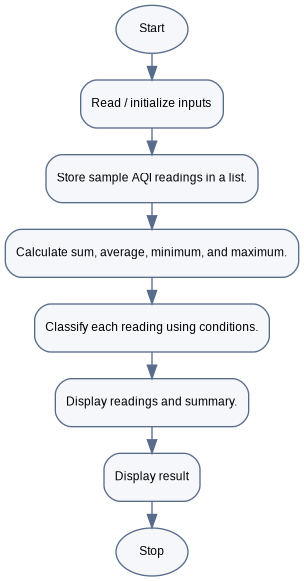

# Case Study 9: Environmental Monitoring Data Analyzer

## Problem statement
Analyze sample air-quality index readings, compute the average and extremes, and classify each reading using defined AQI bands.

## Objectives
- Implement a logical solution using beginner Python concepts.
- Validate the relevant inputs and calculate the required result.
- Display a clear summary.

## Assumptions
AQI readings are hypothetical sample data. Classification bands used in this project: 0–50 Good, 51–100 Moderate, 101–150 Unhealthy for Sensitive Groups, 151–200 Unhealthy, above 200 Very Unhealthy.

## Algorithm
1. Store sample AQI readings in a list.
2. Calculate sum, average, minimum, and maximum.
3. Classify each reading using conditions.
4. Display readings and summary.

## Flowchart


## Pseudocode
```text
START
SET AQI readings list
CALCULATE average, minimum, maximum
FOR each reading: classify by range
DISPLAY all readings and summary
STOP
```

## Python source code
```python
readings = [42, 68, 115, 173, 95]
total = 0
for value in readings:
    total += value
average = total / len(readings)
print("Readings:", readings)
print("Average AQI:", round(average, 2))
print("Minimum:", min(readings), "Maximum:", max(readings))
for value in readings:
    if value <= 50:
        category = "Good"
    elif value <= 100:
        category = "Moderate"
    elif value <= 150:
        category = "Unhealthy for Sensitive Groups"
    elif value <= 200:
        category = "Unhealthy"
    else:
        category = "Very Unhealthy"
    print(value, "-", category)
```

## Test cases
| Input / scenario | Expected result |
|---|---|
| Readings [42,68,115,173,95] | Average 98.60; min 42; max 173; categories Good, Moderate, USG, Unhealthy, Moderate |
| All readings 0 | Average 0; all classified Good |
| Negative reading | Not present in fixed sample list; dynamic validation would be required for user-entered readings |

## Output example
```text
readings=[42,68,115,173,95]
print(sum(readings)/len(readings), min(readings), max(readings))
```

## Conclusion
Use a list, loops, arithmetic, and conditional statements to calculate statistics and classify sample AQI values.
