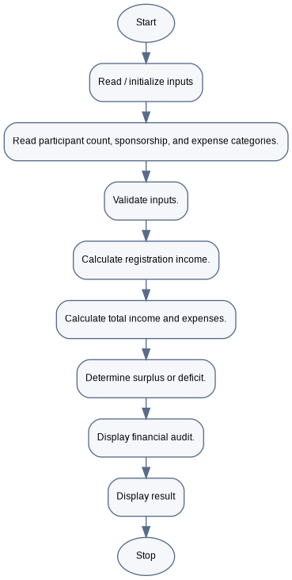

# Case Study 10: Campus Festival Registration and Financial Audit

## Problem statement
Reconcile participant registrations, registration income, sponsorship, and expenses for a campus festival and calculate its final balance.

## Objectives
- Implement a logical solution using beginner Python concepts.
- Validate the relevant inputs and calculate the required result.
- Display a clear summary.

## Assumptions
All figures are sample values. Registration fee is Rs. 150 per participant. Sponsorship and expenses are entered as non-negative amounts. Participants are assumed to have paid the registration fee.

## Algorithm
1. Read participant count, sponsorship, and expense categories.
2. Validate inputs.
3. Calculate registration income.
4. Calculate total income and expenses.
5. Determine surplus or deficit.
6. Display financial audit.

## Flowchart


## Pseudocode
```text
START
INPUT participants, sponsorship, expenses
VALIDATE values
registration income = participants * 150
total income = registration income + sponsorship
total expense = sum expense categories
balance = total income - total expense
IF balance >= 0: DISPLAY surplus
ELSE DISPLAY deficit
DISPLAY audit summary
STOP
```

## Python source code
```python
participants = int(input("Number of participants: "))
sponsorship = float(input("Sponsorship received: Rs. "))
venue = float(input("Venue expense: Rs. "))
food = float(input("Food expense: Rs. "))
transport = float(input("Transport expense: Rs. "))
other = float(input("Other expense: Rs. "))
if participants < 0 or sponsorship < 0 or venue < 0 or food < 0 or transport < 0 or other < 0:
    print("Invalid input")
else:
    registration_income = participants * 150
    total_income = registration_income + sponsorship
    total_expenses = venue + food + transport + other
    balance = total_income - total_expenses
    print("Registration income: Rs.", registration_income)
    print("Total income: Rs.", total_income)
    print("Total expenses: Rs.", total_expenses)
    if balance >= 0:
        print("Surplus: Rs.", balance)
    else:
        print("Deficit: Rs.", -balance)
```

## Test cases
| Input / scenario | Expected result |
|---|---|
| 100 participants, sponsorship 5000, expenses 8000 | Registration Rs. 15,000; income Rs. 20,000; expenses Rs. 8,000; surplus Rs. 12,000 |
| 0 participants, no sponsorship, expenses 1000 | Deficit Rs. 1,000 |
| Negative participants | Invalid input |

## Output example
```text
participants=100; sponsorship=5000; expenses=8000
income=participants*150+sponsorship
balance=income-expenses
print(income, balance)
```

## Conclusion
Calculate registration income, add sponsorship, total expenses, and identify whether the event has a surplus or deficit.
